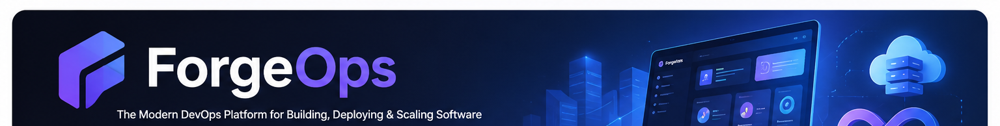
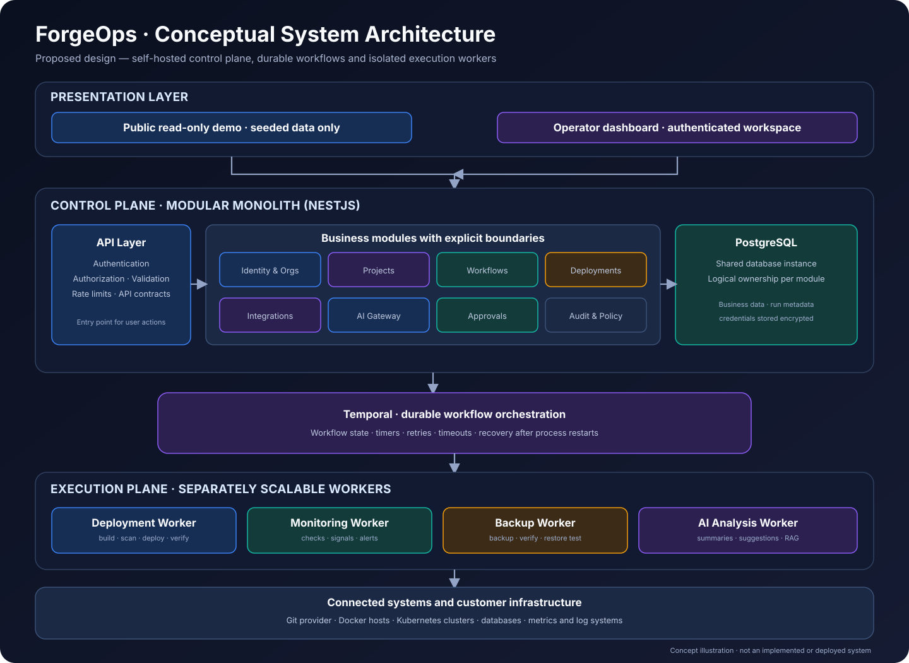
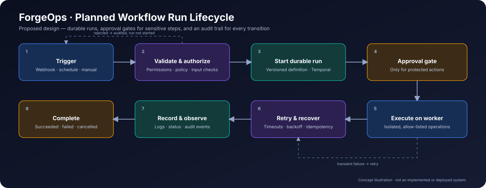

  
  <h1>ForgeOps</h1>
  
<strong>A self-hosted platform for reliable engineering workflow automation.</strong>

  
Define, execute, observe, and govern operational workflows from one developer-focused control plane.

  

    
    
    
    
  

  
<em>Concept visuals are illustrative; they are not screenshots of a running product.</em>

---

## The idea

Engineering teams often manage deployments, scheduled jobs, infrastructure checks, incident response, and operational runbooks across several disconnected tools. The work is repetitive, execution history can be fragmented, and high-impact actions need clear safeguards.

**ForgeOps is being designed to bring those workflows under one self-hosted, auditable system.** Teams will be able to define repeatable workflows, run them through durable workers, inspect every execution, and require human approval before sensitive actions.

ForgeOps is an engineering platform concept—not just an AI chat interface. Its core value is reliable workflow execution, integration boundaries, observability, and operational control. AI is an optional assistant within those guardrails.

## What ForgeOps is intended to do

- **Orchestrate engineering workflows** — trigger workflows from events, schedules, or manual requests.
- **Coordinate deployment tasks** — connect source control, build steps, container tooling, deployment targets, and post-deployment checks.
- **Make operations observable** — provide execution history, status, logs, failure context, and audit events.
- **Support controlled automation** — use policies and human approval gates for sensitive operations.
- **Integrate with existing tools** — connect Git providers, container infrastructure, databases, and monitoring systems through explicit adapters.
- **Add AI assistance responsibly** — summarize incidents, search operational runbooks, and suggest next steps without giving an LLM unrestricted access to production systems.

> **Project status:** ForgeOps is at the early planning and architecture stage. The capabilities above describe the intended product and roadmap; they should not be interpreted as already implemented or production-ready.

## Why this project?

The goal is to explore real software-engineering problems beyond basic CRUD screens:

- durable execution and workflow state;
- retries, timeouts, idempotency, and failure recovery;
- clear module boundaries and dependency rules;
- secure credential handling and least-privilege access;
- human-in-the-loop approvals and auditability;
- worker isolation, horizontal scaling, and observability;
- safe integration of AI into deterministic systems.

These are the engineering concerns the project intends to demonstrate as implementation progresses.

## Proposed architecture

ForgeOps is planned around a **Modular Monolith Control Plane with a separately scalable Execution Plane**.

- The **Control Plane** owns identity, organizations, projects, workflow definitions, integration configuration, policies, approvals, and audit records.
- **Temporal** is planned for durable workflow orchestration, including persisted workflow state, retries, timers, and recovery.
- The **Execution Plane** runs isolated workers for deployment, monitoring, backup, and AI-assisted analysis tasks.
- **PostgreSQL** is the primary relational data store. Modules will have logical ownership of their data even when they share one database instance.
- External systems are accessed through adapters rather than allowing business modules to depend directly on vendor-specific implementations.

*Figure: proposed architecture. This is a design target, not a running deployment.*

### Why a Modular Monolith first?

A modular monolith keeps the initial system straightforward to build, test, and deploy while enforcing boundaries between business capabilities. It avoids the operational overhead of many networked services before the product has proven which parts need independent scaling.

If a module later needs independent scaling or release cycles, it can be extracted into a service using the boundaries and interfaces established from the beginning. The plan is **not** to split everything into microservices prematurely.

### Planned workflow lifecycle

## Planned modules

| Module | Responsibility |
|---|---|
| Identity | Authentication, users, sessions, and access identity |
| Organizations | Organization membership, roles, and tenant boundaries |
| Projects | Repositories, environments, and project-level configuration |
| Workflows | Workflow definitions, versions, triggers, and run coordination |
| Deployments | Build/deploy operations and deployment state |
| Integrations | Adapters for Git providers, container platforms, and external tools |
| AI Gateway | Provider abstraction, model routing, and AI request policies |
| Approvals | Human approval for protected or high-impact actions |
| Audit | Append-oriented activity and execution records |

Modules will communicate through explicit public interfaces or events. A module should not reach into another module's repositories or tables directly. A shared PostgreSQL instance does **not** mean shared ownership of every table.

## AI integration philosophy

AI should assist operators, not become an unrestricted production administrator.

Planned capabilities include incident summarization, log interpretation, runbook retrieval, and proposed remediation steps. Any action that changes infrastructure will pass through explicit permissions, allow-listed operations, and approval policies where appropriate.

Provider access will be designed behind an adapter layer. Depending on the provider's supported authentication model, a user may connect an officially supported account flow, supply their own API credentials, or use a locally hosted model. A consumer AI subscription will **not** be assumed to include API access, and ForgeOps will not bypass provider authentication or billing rules.

## Public demo experience

A recruiter or reviewer should be able to understand the product without creating an account. The intended public demo will be read-only and use seeded sample data to show example workflows, execution history, and architecture concepts.

The demo environment will be isolated from real credentials, customer data, and infrastructure execution. It is a planned feature and is not available yet.

## Proposed technology stack

| Area | Planned technology | Purpose |
|---|---|---|
| Web application | Next.js + TypeScript | Dashboard and public demo |
| Backend | NestJS + TypeScript | Modular Monolith Control Plane |
| Database | PostgreSQL | Relational and operational data |
| Workflow orchestration | Temporal | Durable, long-running workflows |
| Containers | Docker | Local development and worker packaging |
| Reverse proxy | Nginx | Routing and TLS termination in self-hosted deployments |
| Testing | Vitest/Jest + Playwright | Unit, integration, and browser-level tests |
| Observability | Prometheus, Grafana, and structured logs | Metrics and operational visibility |

The stack is a proposal and may evolve as implementation decisions are validated. Additional infrastructure (for example, Redis or a separate message broker) will only be introduced when a concrete requirement justifies it.

## Roadmap

| Stage | Outcome | Status |
|---|---|---|
| 1. Product foundation | Product specification, architecture diagrams, and architecture decision records | Planned |
| 2. Backend foundation | NestJS app, module boundaries, database migrations, health endpoint | Planned |
| 3. Workflow core | Versioned workflow definitions, durable runs, retries, and execution history | Planned |
| 4. First integration | Git webhook trigger and a Docker-based sandbox worker | Planned |
| 5. Safe operations | Approval gates, permissions, audit events, and secret handling | Planned |
| 6. Public demo | Isolated, read-only demo with seeded workflows and sample execution history | Planned |
| 7. AI assistance | Provider adapters, incident summaries, and runbook retrieval | Planned |
| 8. Production hardening | Load tests, recovery tests, observability, and deployment guides | Planned |

## Engineering principles

1. **Human-led development:** architecture and scope are decided deliberately; AI coding tools assist with bounded tasks.
2. **Small, reviewable changes:** each feature should have a defined scope, tests, and a reviewable pull request.
3. **Reliability over happy-path demos:** test retries, duplicate events, worker restarts, and partial failures.
4. **Secure by design:** least privilege, encrypted secrets, redacted logs, and auditable privileged actions.
5. **Explicit boundaries:** modules expose public interfaces; internal repositories and implementation details remain private to their owning module.
6. **Document decisions:** important trade-offs are recorded as Architecture Decision Records (ADRs).

## Repository status and getting started

This repository is currently in its planning stage. The application scaffold and runnable development environment have not been published yet, so there are no setup commands to run at this point. Installation and contribution instructions will be added once the first executable milestone is ready.

## Contributing and feedback

Feedback on the product scope, workflow model, module boundaries, and architecture trade-offs is welcome. Contribution guidelines and licensing will be added when the repository moves from planning into active implementation.

---

  <strong>ForgeOps — Make engineering operations repeatable, observable, and controlled.</strong>
   
  Designed for self-hosted environments. Built with a human-in-control approach to automation.

